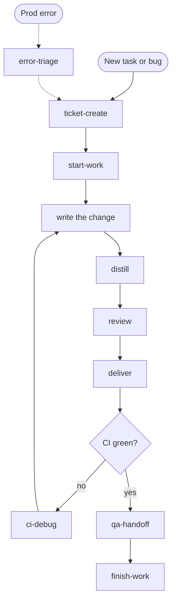

# ai-recipes

A pattern library for AI-assisted development commands.

Each recipe describes the **idea** of a command — the problem it solves,
the algorithm, the tradeoffs — without committing to a specific stack
or tool. You hand the recipe to your AI assistant (Claude Code, Cursor,
Cline, Continue, or any other), and it generates a command tailored to
**your** ticket tracker, **your** CI, **your** conventions.

## Why concepts, not implementations?

Implementations rot. Tools rename. Internal URLs leak into commits.

A concept is a durable pattern. It teaches the *why* and lets the AI
handle the *how* for your specific environment. The same recipe works
whether you use Jira or Linear, Jenkins or GitHub Actions, npm or uv.

## How to use a recipe

1. Browse [commands/](commands/) and pick one that solves a problem you have.
2. Paste it into your AI assistant with a prompt like:

   > Here's a recipe for a slash command. Build me a version for my stack:
   > ticket tracker = Linear, CI = GitHub Actions, package manager = pnpm.
   > Format it for my AI tool (Claude Code slash command, Cursor custom
   > command, Cline mode, etc.).

3. The AI generates a command tailored to your setup. Tweak as needed.

## Some recipes ship my real command

A few recipes are tool-agnostic enough that they also bundle the actual slash
command I run day to day — pasted verbatim at the bottom of the recipe under a
**Ready-to-use command** section. Copy it and go; no adaptation needed for the
common case.

**Example:** [**distill**](commands/distill.md) — the recipe explains the idea
(a quality-only cleanup pass over your diff), and right below it ships my real
Claude Code command so you can run it as-is.

These recipes are marked 🧩 in the list below. Heads-up: the bundled command is
in Claude Code format (`$ARGUMENTS`, a Task-tool parallel fan-out). On Cursor /
Cline / Continue, either run the recipe through your assistant as usual, or use
the recipe's single-agent variation. Tool-coupled recipes (anything that talks
to a ticket tracker, CI, or error tracker) stay concept-only on purpose — that's
exactly where a hardcoded command rots on someone else's machine.

## Recipes

### Commands

- [**start-work**](commands/start-work.md) — turn a ticket reference into
  a ready-to-code workspace: branch in an isolated worktree, dependencies
  installed, env files copied.
- [**finish-work**](commands/finish-work.md) — safely tear down a worktree
  when work is done: safety checks for uncommitted changes and unpushed
  commits, then remove the worktree, optionally delete the local branch.
- [**qa-handoff**](commands/qa-handoff.md) — post a fix summary and QA
  test plan to the ticket so QA picks it up cleanly.
- [**review**](commands/review.md) — review the current branch's diff
  against a fixed checklist (bugs, security, conventions), then apply the
  fixes you select.
- [**error-triage**](commands/error-triage.md) — turn an error-tracker
  issue into a structured root-cause analysis with stacktrace, impact, and
  a suggested fix.
- [**ci-debug**](commands/ci-debug.md) — triage a failing CI build: fetch
  the log, classify code-vs-infra, suggest a fix — read-only, log kept out
  of context.
- [**deliver**](commands/deliver.md) — ship the current branch: gate on
  lint and type-check, commit with the ticket key, push, and open a PR.
- [**ticket-create**](commands/ticket-create.md) — file a tracker ticket
  from the conversation, deriving the summary and body from context without
  fabricating details.
- 🧩 [**distill**](commands/distill.md) — run a quality-only cleanup pass: four
  parallel agents flag reuse, simplification, efficiency, and altitude issues,
  then apply the safe fixes (no bug-hunting — that's a separate review).
  *Ships my real Claude Code command.*
- 🧩 [**tldr**](commands/tldr.md) — re-explain the last answer as a skimmable
  digest: a one-line TL;DR, a compact table or a few bullets, an optional
  decision line. *Ships my real Claude Code command.*
- 🧩 [**eli5**](commands/eli5.md) — re-explain the last thing in the simplest
  terms — one everyday analogy, no jargon — so a non-engineer gets it on the
  first read. *Ships my real Claude Code command.*
- 🧩 [**flow**](commands/flow.md) — narrate a feature end-to-end as one linear
  story (page → endpoint → jobs → data → what the user sees), not a line-by-line
  code trace. *Ships my real Claude Code command.*

## Suggested pipeline

The recipes are built to chain. A typical task flows top to bottom; the dashed
paths are the "something went wrong" branches that loop you back in.

1. **ticket-create** — file the ticket from the conversation (skip if it already exists).
2. **start-work** — turn the ticket into an isolated workspace: branch in a worktree, deps installed, env copied.
3. *Write the change.*
4. **distill** — quality-only cleanup pass on the diff (reuse, simplification, efficiency, altitude).
5. **review** — AI review for bugs, security, and repo conventions; apply the fixes you accept.
6. **deliver** — lint + type-check gate, ticket-prefixed commit, push, open the PR.
7. **ci-debug** — if the build goes red, triage code-vs-infra and loop back to the fix.
8. **qa-handoff** — once green, post a fix summary and QA plan onto the ticket.
9. **finish-work** — after merge, tear down the worktree safely.

**error-triage** sits off the happy path: a production error becomes a root-cause
analysis that feeds a fresh ticket, re-entering the pipeline at the top.

> Recipe names are generic here. In your own setup they may be prefixed or
> renamed (e.g. a Claude Code build might expose `start-work` as `/eva-start-work`).

## License

[MIT](LICENSE)